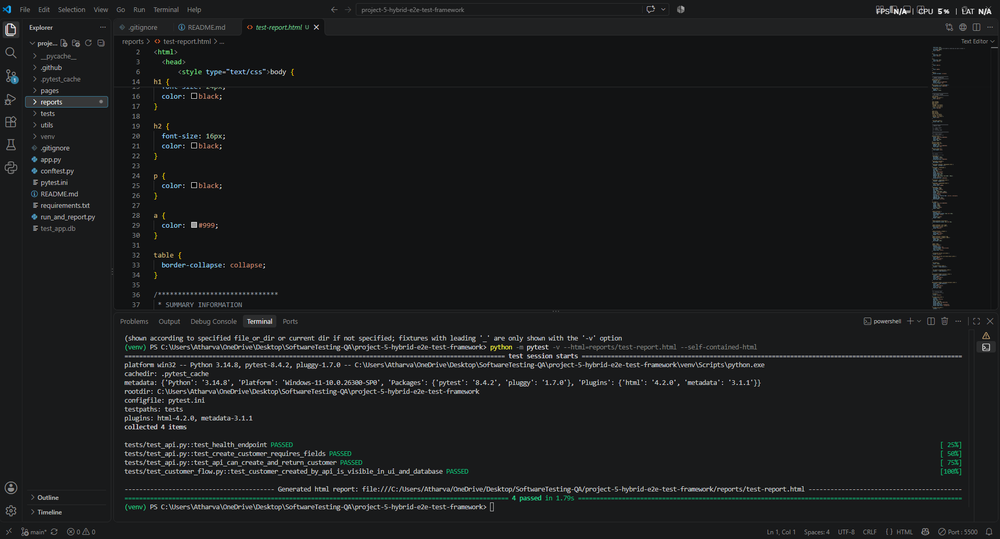
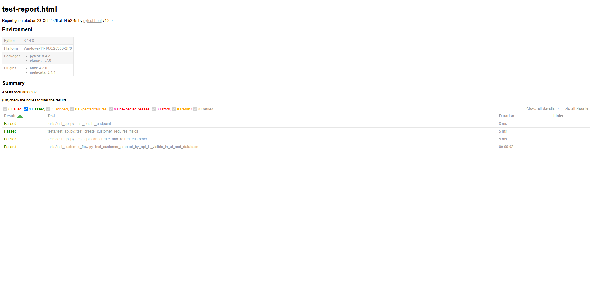
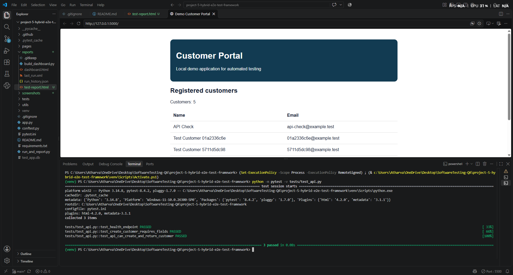
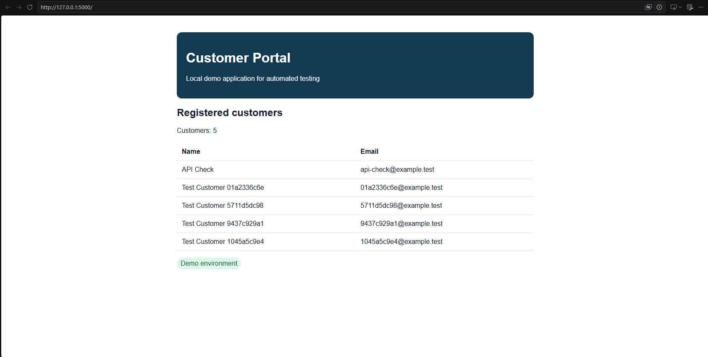
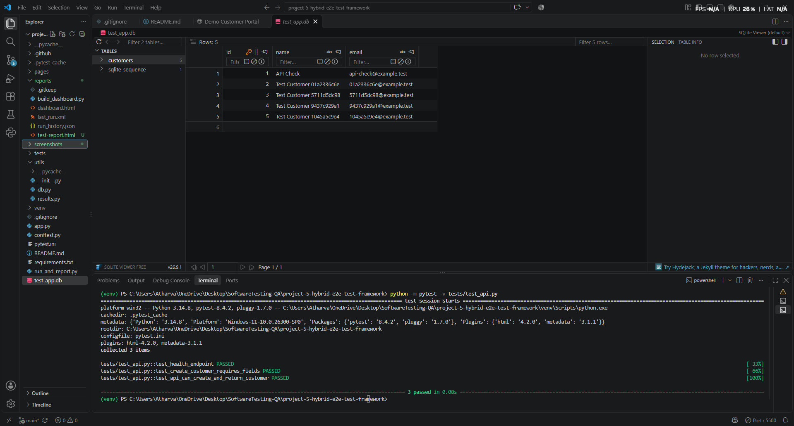
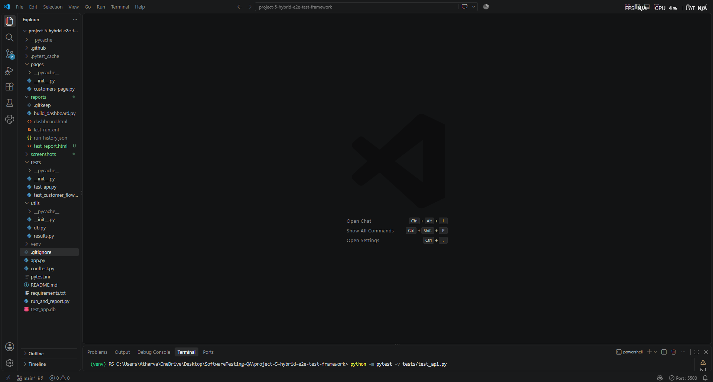

# Hybrid E2E Test Automation Framework

A Python-based test automation project that validates a customer workflow across **REST APIs, browser UI interactions, and SQLite database persistence**.

The goal of this project is to demonstrate how different testing layers can work together to verify that a feature behaves correctly from the API request to the user interface and the underlying database.

## Project Overview

In a typical application, an API can return a successful response while the UI or database behaves incorrectly. This project combines multiple testing approaches to catch inconsistencies across these layers.

The framework uses a small Flask demo application with a customer workflow and automated tests built using Pytest and Playwright.

## What This Project Tests

- **API testing:** Validate API responses and customer-related operations.
- **UI automation:** Use Playwright to interact with the customer interface in a real browser.
- **Database validation:** Check SQLite persistence to verify that customer data is stored correctly.
- **Reusable test setup:** Use Pytest fixtures and shared utilities to reduce duplication.
- **Page Object Model:** Keep browser interactions separate from test assertions.
- **Test reporting:** Generate a run summary containing test results, duration, and run history.
- **CI integration:** Include a GitHub Actions workflow for automated test execution.

## Test Workflow

The main end-to-end scenario connects the different testing layers:

1. Prepare the application and test environment.
2. Create or process customer data through the API.
3. Open the application using Playwright and verify the corresponding UI behaviour.
4. Validate that the expected customer data persists in SQLite.
5. Execute assertions and collect test results.
6. Generate a test-run report.

This approach helps identify failures that isolated API or UI tests might not catch.

## Tech Stack

| Technology | Purpose |
|---|---|
| Python | Core programming language |
| Pytest | Test execution, assertions, and fixtures |
| Playwright | Browser-based UI automation |
| Flask | Demo application and API endpoints |
| SQLite | Persistent test data storage |
| Git & GitHub | Version control and project hosting |
| GitHub Actions | CI workflow configuration |

## Project Structure

```text
project-5-hybrid-e2e-test-framework/
├── .github/
│   └── workflows/
│       └── tests.yml
├── pages/
│   ├── __init__.py
│   └── customers_page.py
├── reports/
│   ├── .gitkeep
│   └── build_dashboard.py
├── tests/
│   ├── __init__.py
│   ├── test_api.py
│   └── test_customer_flow.py
├── utils/
│   ├── __init__.py
│   ├── db.py
│   └── results.py
├── app.py
├── conftest.py
├── pytest.ini
├── requirements.txt
├── run_and_report.py
└── README.md
```

## Getting Started

### 1. Clone the repository

```bash
git clone https://github.com/YOUR-USERNAME/hybrid-e2e-test-framework.git
cd hybrid-e2e-test-framework
```

Replace `YOUR-USERNAME` with your GitHub username.

### 2. Create a virtual environment

**Windows PowerShell:**

```powershell
python -m venv .venv
.\.venv\Scripts\Activate.ps1
```

### 3. Install dependencies

```bash
python -m pip install -r requirements.txt
python -m playwright install chromium
```

### 4. Run the application

In the first terminal:

```bash
python app.py
```

Keep the application running while executing tests that depend on it.

### 5. Run the tests

Open a second terminal, activate the same virtual environment, and execute:

```bash
python -m pytest -v
```

To run the project's reporting script:

```bash
python run_and_report.py
```

Check the script and test configuration for any additional setup required by your environment.

## Test Reporting

The project includes utilities for summarising test execution and generating a dashboard.

The reporting workflow is intended to help inspect:

- Test pass/fail counts
- Execution duration
- Run history
- Summary information for previous executions

Generated reports are local outputs and are excluded from version control where configured.

## Test Execution Results

The current local test run completed successfully:

- **Full test suite:** 4 tests passed.
- **API test suite:** 3 tests passed.
- **Workflow:** API behaviour, browser UI verification, and SQLite persistence.

Run the full suite from the project root:

```powershell
python -m pytest -v
```

Run only the API tests:

```powershell
python -m pytest -v tests/test_api.py
```

Generate an HTML report (requires `pytest-html`):

```powershell
python -m pytest -v --html=reports/test-report.html --self-contained-html
```

These results describe the local run and are not a claim about a remote CI run.

## Screenshots

The `screenshots/` folder contains evidence from the local test run and project structure.

### 1. Full Test Execution



### 2. HTML Test Report



### 3. API Tests



### 4. Customer Portal UI



### 5. SQLite Database Verification



### 6. Project Structure



> Screenshot links are relative to this repository. Keep the image files in `screenshots/` and make sure their names match the links above. If Windows is hiding file extensions, verify the actual extensions before committing.

## Engineering Practices Demonstrated

- Separation of test logic and page interactions
- Reusable fixtures and helper functions
- API, UI, and database-level assertions
- Test configuration through Pytest
- Dependency management using `requirements.txt`
- Version control and CI workflow configuration

## Current Scope and Limitations

This is a learning and portfolio project built around a demo application. It is not intended to represent a production-scale testing platform.

Test results and CI status depend on the environment and the tests actually executed. Performance benchmarks, coverage percentages, and reliability metrics should only be reported after they have been measured.

## Future Improvements

- Add negative and boundary-value test scenarios.
- Improve test-data isolation and cleanup.
- Capture browser screenshots and traces on failure.
- Expand CI reporting and artifact retention.
- Add API schema validation and broader database integrity checks.

## Author

**Atharva Nandgaonkar**

Python Test Automation | API Testing | UI Automation | Pytest | Playwright
